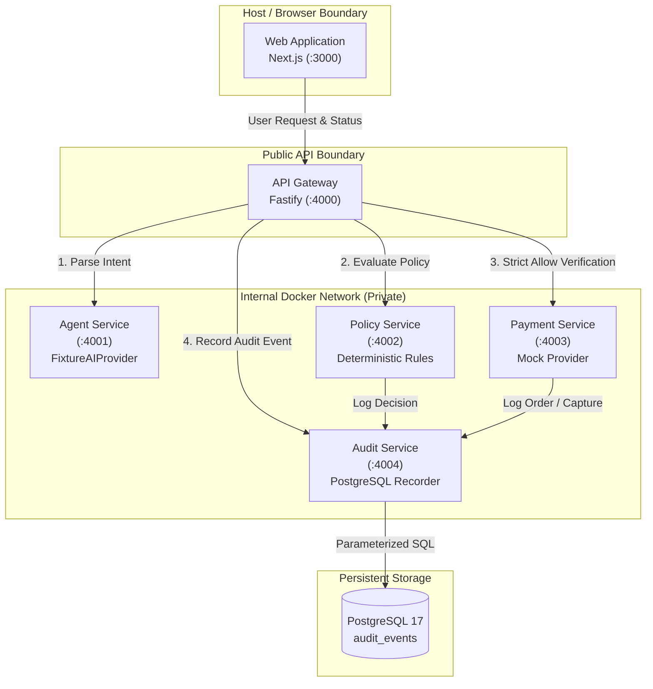

# AgentPay

> **"AI proposes. Policy enforces. PayPal executes. The audit trail proves what happened."**

AgentPay is a verifiable payment-authorization and audit platform for autonomous AI agents. It establishes an unbypassable policy and audit perimeter between non-deterministic AI agent reasoning and actual financial execution.

---

## Architecture Overview



---

## Engineering Foundation Status & Provider Notice

> [!WARNING] > **DEVELOPMENT / ENGINEERING FOUNDATION PHASE**
>
> 1. **Sandbox Not Configured**: Real PayPal Sandbox OAuth credentials and order lifecycle verification have **not yet been configured** in this foundation phase.
> 2. **Mock Provider Active**: The payment service operates strictly under a `MOCK/DEVELOPMENT` provider that transfers zero funds. Payment execution is disabled by default (`PAYMENTS_ENABLED=false`).
> 3. **Non-Production Notice**: Do not use this configuration in production or with live financial accounts.

---

## Repository Structure

```
AgentPay/
├── apps/
│   └── web/                     # Next.js 15 Web Application (:3000)
├── services/
│   ├── api-gateway/             # Fastify API Gateway (:4000)
│   ├── agent-service/           # Agent Intent & Proposal Service (:4001)
│   ├── policy-service/          # Deterministic Policy Engine (:4002)
│   ├── payment-service/         # Payment Provider Abstraction & Mock (:4003)
│   └── audit-service/           # Sanitized PostgreSQL Audit Service (:4004)
├── packages/
│   ├── contracts/               # Shared Zod schemas and TypeScript interfaces
│   ├── config/                  # Validated environment configuration loaders
│   ├── logger/                  # Pino-based structured JSON logger with redaction
│   └── test-utils/              # Deterministic test factories and fixtures
├── db/
│   ├── migrations/              # Versioned SQL migrations (001_create_audit_events.sql)
│   └── migrate.ts               # Idempotent migration runner
├── tests/
│   ├── integration/             # Migration and cross-service integration tests
│   └── e2e/                     # Playwright end-to-end browser test suite
├── docs/                        # Architecture, threat model, development, testing, CI/CD
├── .github/workflows/           # CI/CD GitHub Actions workflows
├── docker-compose.yml           # Production-ready multi-service Docker Compose configuration
├── .env.example                 # Safe environment configuration template
└── README.md
```

---

## Service Ports & Health Endpoints

| Service             | Port   | Host Exposed                  | Health Endpoint   |
| :------------------ | :----- | :---------------------------- | :---------------- |
| **Web Application** | `3000` | Yes (`http://localhost:3000`) | `GET /`           |
| **API Gateway**     | `4000` | Yes (`http://localhost:4000`) | `GET /api/health` |
| **Agent Service**   | `4001` | Internal Docker Network only  | `GET /health`     |
| **Policy Service**  | `4002` | Internal Docker Network only  | `GET /health`     |
| **Payment Service** | `4003` | Internal Docker Network only  | `GET /health`     |
| **Audit Service**   | `4004` | Internal Docker Network only  | `GET /health`     |
| **PostgreSQL**      | `5432` | Internal Docker Network only  | `pg_isready`      |

---

## Prerequisites

- **Node.js**: `v24.x LTS` (verified with `v24.12.0`)
- **pnpm**: `9.15.4` or later
- **Docker & Docker Compose**: Docker 24+ (Compose v2.20+)

---

## Quickstart (Docker-First)

### 1. Configure Environment

```bash
cp .env.example .env
```

### 2. Validate Compose Configuration

```bash
docker compose config
```

### 3. Build & Launch Containers

```bash
docker compose up -d --build
```

### 4. Check Health & Logs

```bash
docker compose ps
docker compose logs --tail=100
```

### 5. Open Web Dashboard

Navigate to [http://localhost:3000](http://localhost:3000) to view the service status monitor and policy simulator.

### 6. Stop Containers Gracefully

```bash
docker compose down
```

> [!CAUTION]
> Never use `docker compose down -v` as a routine command, because it will destroy the persistent PostgreSQL volume storing your audit history.

---

## Local Development (Without Docker)

1. Start PostgreSQL:
   ```bash
   docker compose up -d postgres
   ```
2. Run database migrations:
   ```bash
   pnpm db:migrate
   ```
3. Run microservices and web application:
   ```bash
   pnpm dev
   ```

---

## Testing Commands

```bash
# Run all Vitest unit and integration tests
pnpm test

# Run unit tests only
pnpm test:unit

# Run migration and integration tests
pnpm test:integration

# Run Playwright E2E tests (Chromium)
pnpm test:e2e

# Run TypeScript type check across all workspaces
pnpm typecheck

# Run ESLint
pnpm lint

# Check formatting
pnpm format
```

---

## Troubleshooting

### Windows Line Endings (`CRLF` vs `LF`)

If shell scripts or Dockerfiles fail on Windows due to line endings, Git can convert line endings automatically. Ensure `.gitattributes` or your editor preserves `LF` for Docker files:

```bash
git config core.autocrlf input
```

### Port Conflicts (3000 or 4000 already in use)

If port 3000 or 4000 is occupied by another process on your machine, edit `.env`:

```env
WEB_PORT=3001
API_GATEWAY_PORT=4010
```

### Docker Volume Reset (Clean Slate)

To perform a complete clean slate rebuild (deleting test database data):

```bash
docker compose down -v
docker compose up -d --build
```

---

## Next Milestones

1. **PayPal Sandbox OAuth Verification**: Connect real PayPal Developer credentials, fetch access tokens, and verify Sandbox API responses.
2. **Order Lifecycle End-to-End**: Create genuine PayPal Sandbox orders, capture funds, and verify webhook signatures.
3. **Cryptographic Tamper-Evidence**: Implement Merkle hashing or external cryptographic notarization over the PostgreSQL audit table.
4. **Human Approval Portal**: Web UI workflow allowing administrators to review and approve proposals flagged with `REQUIRE_APPROVAL`.

---

## License

Licensed under the [Apache License, Version 2.0](LICENSE).
