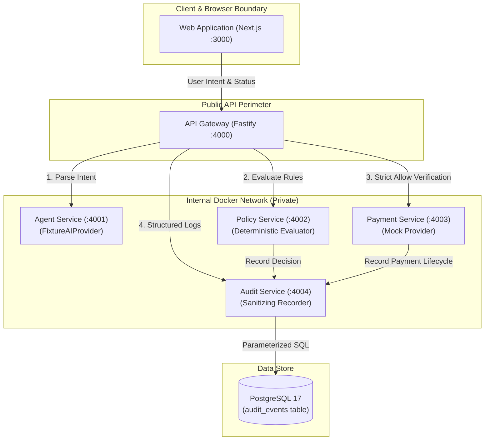

# AgentPay System Architecture

AgentPay is a verifiable payment-authorization and audit platform for autonomous AI agents.

## Core Principle

> **"AI proposes. Policy enforces. PayPal executes. The audit trail proves what happened."**

AgentPay enforces a strict security boundary between autonomous agent reasoning and actual financial movement. AI agents are inherently non-deterministic and prompt-injectable; therefore, they must never possess direct payment credentials or authority to execute fund transfers.

## Microservices Breakdown

| Service                      | Port | Description                 | Responsibilities                                                                                                                                                                                                                        |
| :--------------------------- | :--- | :-------------------------- | :-------------------------------------------------------------------------------------------------------------------------------------------------------------------------------------------------------------------------------------- |
| **apps/web**                 | 3000 | Next.js Frontend            | AgentPay branded dashboard, service status monitor, purchase proposal & policy simulator, audit event viewer.                                                                                                                           |
| **services/api-gateway**     | 4000 | Fastify API Gateway         | Single public ingress. Enforces CORS, rate limiting, request size limits, correlation ID propagation, and **never allows bypass of the Policy Service**.                                                                                |
| **services/agent-service**   | 4001 | Autonomous Agent Service    | Implements `AIProvider` interface. Uses a deterministic, catalog-backed fixture to construct verified proposals. **Does not let agent text dictate authoritative pricing**.                                                             |
| **services/policy-service**  | 4002 | Deterministic Policy Engine | Evaluates proposals against strict financial limits (hard ceiling, high-value human approval threshold, currency whitelist, and blacklisted merchant categories). Returns typed `PolicyDecision` (`ALLOW`, `DENY`, `REQUIRE_APPROVAL`). |
| **services/payment-service** | 4003 | Payment Execution Service   | Implements `PaymentProvider` interface. In this foundation phase, operates strictly in `MOCK/DEVELOPMENT` mode. Payment operations are disabled by default (`PAYMENTS_ENABLED=false`).                                                  |
| **services/audit-service**   | 4004 | Audit & Compliance Service  | Implements `AuditRepository` with PostgreSQL persistence. Automatically strips secrets, passwords, tokens, and authorization headers prior to storage.                                                                                  |

## Inter-Service Communication

Services communicate via HTTP/REST using Docker internal DNS names (`http://agent-service:4001`, `http://policy-service:4002`, `http://payment-service:4003`, `http://audit-service:4004`). Only `web` (3000) and `api-gateway` (4000) expose ports to the host machine.
