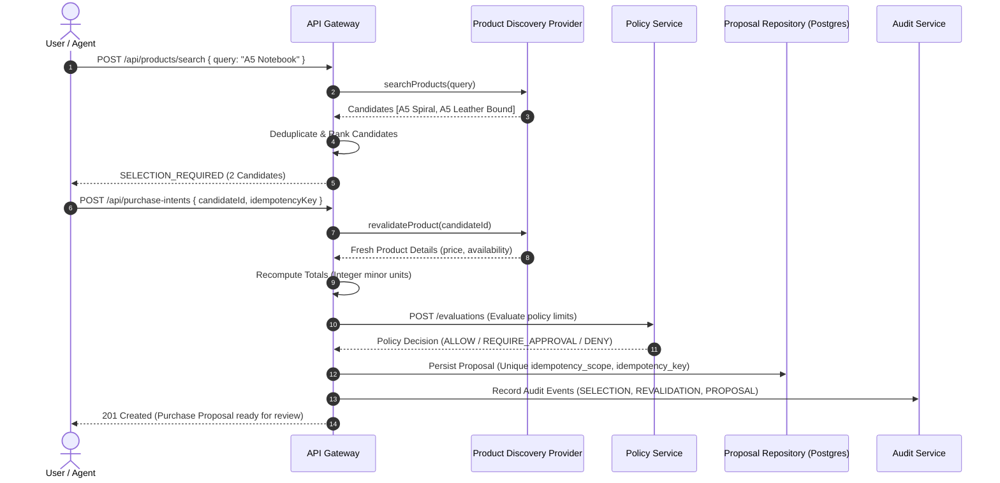

# AgentPay — Phase 3B Product Discovery & Catalog Integration Architecture Design

**Date:** 2026-10-25  
**Author:** Principal Software Architect, Application Security & API Integration  
**Status:** APPROVED FOR IMPLEMENTATION  

---

## 1. Executive Summary and Objectives

Phase 3A established a verifiable purchase intent workflow: natural-language intent parsing, server-side policy evaluation, durable purchase proposals with idempotency scoping, and structured audit events. However, catalog items were resolved exclusively against a fixed in-memory development array (`DEV_CATALOG`).

**Phase 3B Objectives:**
1. Introduce an extensible, secure **Product Discovery & Catalog Integration Boundary** behind the existing `resolveCatalogItem` and catalog contracts.
2. Define a normalized, versionable, strict contract for external product candidates (`ProductCandidate`).
3. Support query normalization, bounded pagination, $O(n)$ hash-based deduplication, and deterministic explainable ranking.
4. Enforce the **Selection Invariant**: ambiguous searches return `SELECTION_REQUIRED`; candidates cannot automatically authorize payments or skip server-side revalidation.
5. Provide a deterministic `MockProductDiscoveryProvider` fixture suite alongside an external HTTP discovery adapter architecture.
6. Revalidate selected candidates server-side prior to policy evaluation, recalculating integer minor-unit amounts and verifying price freshness.
7. Maintain strict fail-closed identity, non-monetary safety (`PAYMENTS_ENABLED=false`), and zero-trust boundaries.

---

## 2. SOLID Architectural Design

### 2.1 Single Responsibility Principle (SRP)
- **Transport / HTTP Adapter (`ProductDiscoveryProvider`):** Exclusively handles external provider communication, request timeouts, and raw response parsing.
- **Validation Layer (`ProductCandidateSchema`):** Strictly validates provider payloads at the boundary before internal propagation.
- **Normalization & Sanitization (`normalizeSearchQuery`, `normalizeCandidate`):** Cleans queries (Unicode NFKC, control character stripping) and transforms external data into standard minor units.
- **Ranking & Selection Engine (`rankCandidates`, `deduplicateCandidates`):** Orders candidates deterministically and decides whether `SELECTION_REQUIRED` must be returned.
- **Catalog Resolver (`CatalogResolver`):** Coordinates search and authoritative revalidation.
- **Gateway Orchestrator:** Manages client authentication, rate limiting, and connects revalidated products to the existing policy and durable proposal pipeline.

### 2.2 Open/Closed Principle (OCP)
- New discovery providers (e.g., Google Shopping, Amazon Product Advertising, FakeStore, Shopify) can be added simply by implementing `ProductDiscoveryProvider` without changing gateway orchestration or policy evaluation logic.

### 2.3 Liskov Substitution Principle (LSP)
- Any implementation of `ProductDiscoveryProvider` adheres to identical error codes, cancellation semantics, and bounded retrieval guarantees.

### 2.4 Interface Segregation Principle (ISP)
- `ProductDiscoveryProvider` exposes only narrow search and revalidation capabilities:
  ```ts
  interface ProductDiscoveryProvider {
    readonly providerId: string;
    searchProducts(query: ProductSearchQuery, options?: RequestOptions): Promise<ProductSearchResult>;
    revalidateProduct(productId: string, options?: RequestOptions): Promise<ProductCandidate | null>;
  }
  ```

### 2.5 Dependency Inversion Principle (DIP)
- Gateway orchestration depends on the abstract `ProductDiscoveryProvider` interface rather than concrete provider classes. Providers are injected during server instantiation.

---

## 3. Domain Contracts and Normalized Schemas

### 3.1 Normalized Product Candidate Schema

```ts
export const ProductCandidateSchema = z.object({
  providerId: z.string().min(1).max(64),
  providerProductId: z.string().min(1).max(128),
  merchantId: z.string().min(1).max(64),
  merchantName: z.string().min(1).max(128),
  title: z.string().min(1).max(256),
  description: z.string().max(1024).optional(),
  productUrl: z.string().url().refine(url => /^https?:\/\//i.test(url), {
    message: 'Product URL must have http or https scheme',
  }),
  imageUrl: z.string().url().optional(),
  unitPriceMinor: z.number().int().nonnegative(),
  currency: z.string().length(3).regex(/^[A-Z]{3}$/),
  currencyDecimals: z.number().int().min(0).max(3).default(2),
  priceFreshnessTimestamp: z.string().datetime(),
  priceProvenance: z.enum(['PROVIDER_VERIFIED', 'SEARCH_INFORMATIONAL', 'REVALIDATED']),
  availability: z.enum(['IN_STOCK', 'OUT_OF_STOCK', 'LIMITED', 'UNKNOWN']).default('IN_STOCK'),
  category: z.string().max(64).default('general'),
  dedupeKey: z.string().min(1),
  metadata: z.record(z.unknown()).optional(),
});
```

### 3.2 Provenance and Trust Hierarchy

1. **Unverified Search Candidate (`SEARCH_INFORMATIONAL`):** Returned by search queries. Useful for display and user selection, but **never** trusted for direct proposal creation.
2. **Server-Revalidated Product (`REVALIDATED`):** Re-fetched via provider product-detail endpoint directly by the backend before policy evaluation. Fresh price and inventory are verified.
3. **Durable Proposal (`PROPOSAL_CREATED`):** Immutable proposal record saved in PostgreSQL with full policy decision ID and idempotency scope.

---

## 4. Search and Selection Algorithms

### 4.1 Deterministic Query Normalization
- Enforce Unicode normalization form NFKC.
- Strip control characters (`[\x00-\x1F\x7F]`) and dangerous input.
- Collapse consecutive whitespace into single space.
- Bound query string length: minimum 1 character, maximum 120 characters.
- Preserve model numbers (e.g. `XPS 15`, `RTX 4090`), SKU codes, and currency symbols.

### 4.2 $O(n)$ Hash-Based Deduplication
- For a batch of $n$ candidates, compute deduplication key:
  $$\text{dedupeKey} = \text{providerId} + \text{":"} + \text{providerProductId}$$
- When multiple identical items are returned, retain the candidate with the highest price freshness timestamp or richest metadata. Time complexity: $O(n)$, space complexity: $O(n)$.

### 4.3 Deterministic Ranking and Ambiguity Detection
- Candidate scoring formula:
  $$\text{Score} = w_{\text{model}} \cdot S_{\text{model}} + w_{\text{title}} \cdot S_{\text{title}} + w_{\text{brand}} \cdot S_{\text{brand}} + w_{\text{data}} \cdot S_{\text{data}}$$
  where:
  - $w_{\text{model}} = 40$ (exact SKU/model identifier match)
  - $w_{\text{title}} = 30$ (token overlap in normalized title)
  - $w_{\text{brand}} = 20$ (merchant or brand match)
  - $w_{\text{data}} = 10$ (presence of image, verified price, in-stock status)
- Tie-breaker: lexicographical sort by `providerProductId`.
- **Selection Invariant:** If multiple candidates have plausible scores ($> 30$) or title similarity, return `status: "SELECTION_REQUIRED"`. Never auto-select based solely on lowest price or heuristic confidence.

---

## 5. User Selection & Authoritative Revalidation Flow



---

## 6. Security and Resilience Engineering

### 6.1 SSRF & URL Sanitization
- Provider base URLs are strictly configured server-side via environment variables; never derived from user input.
- External product URLs and image URLs are treated as inert strings: backend never executes HTTP requests against external product URLs.
- URL schemes are restricted to `https:` and `http:`. `javascript:`, `file:`, `data:`, and local IP ranges (`127.0.0.1`, `169.254.169.254`, `10.0.0.0/8`, `192.168.0.0/16`) are blocked.

### 6.2 Timeouts and Cancellation
- External provider calls enforce strict bounded timeouts (`timeoutMs: 4000`).
- Calls utilize `AbortController` and propagate signals to cancel socket connections on client disconnect.

### 6.3 Price Integrity
- No floating-point math: all monetary calculations use `safeIntegerMultiply` and `safeIntegerAdd`.
- Currency precision metadata is enforced (JPY: 0 decimals, USD/EUR/GBP: 2 decimals, BHD/KWD: 3 decimals).
- Unverified external price changes between search and selection trigger `PRICE_CHANGED_RECONFIRMATION_REQUIRED`.

---

## 7. Provider Implementation Strategy

AgentPay includes:
1. **`MockProductDiscoveryProvider`**: Deterministic provider with test fixtures covering exact matches, multi-candidate selection, price modifications, out-of-stock items, and timeouts. Enabled by default for all test and offline environments.
2. **`HttpProductDiscoveryProvider`**: Generic REST/HTTP discovery adapter with bounded retries, abort signals, and strict response schema validation.
