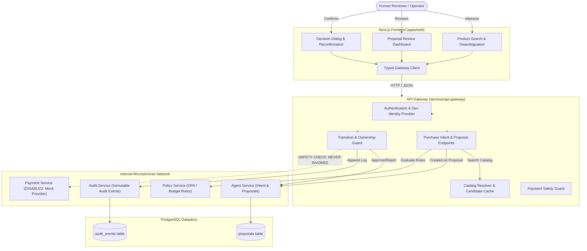

# Phase 3C — Architecture & System Design
## Human-in-the-Loop Purchase Authorization Dashboard

### 1. Executive Overview

Phase 3C delivers the human-in-the-loop authorization dashboard for AgentPay. It translates autonomous agent purchase intentions into verifiable, human-governed authorization decisions.

Crucially, **Phase 3C is an authorization and governance layer, NOT a payment execution engine**.
`PAYMENTS_ENABLED=false` remains strictly enforced across all environments. Approving a proposal records an explicit human authorization transition, transactionally persists a verifiable audit trail, and prepares the proposal for downstream processing without ever invoking payment capture, transfers, or order execution.

---

### 2. End-to-End Vertical Slice Architecture



---

### 3. Component Hierarchy (`apps/web`)

The frontend application adopts a modular, SOLID-compliant component structure:

```
apps/web/src/
├── app/
│   └── page.tsx                     # Main layout with tabbed navigation (Catalog, Proposals, Simulator)
├── components/
│   ├── catalog/
│   │   ├── ProductSearchForm.tsx    # Query input with validation & keyboard support
│   │   ├── CandidateCard.tsx        # Individual product candidate presentation & selection
│   │   ├── CandidateList.tsx        # Disambiguation list & explicit selection action
│   │   └── PriceChangeModal.tsx     # 409 reconfirmation dialog with before/after diff
│   ├── proposals/
│   │   ├── ProposalList.tsx         # Responsive list of proposals with status filtering
│   │   ├── ProposalDetail.tsx       # Authoritative breakdown of merchant, items, policy & actions
│   │   ├── ProposalAuditTimeline.tsx# Verifiable append-only audit event history
│   │   └── DecisionDialog.tsx       # Confirmation modal for explicit approval or rejection
│   └── ui/
│       ├── Alert.tsx                # Contextual alert banner (info, success, warning, error)
│       ├── Badge.tsx                # Status badge with semantic color mappings
│       ├── Button.tsx               # Accessible button with loading spinner & disabled states
│       └── Modal.tsx                # Keyboard & focus-trapped accessible dialog
└── lib/
    ├── api/
    │   └── client.ts                # Centralized typed HTTP client with error normalization
    └── formatting/
        └── currency.ts              # Financial minor-unit formatter (0, 2, and 3-decimal currencies)
```

---

### 4. Core Request & Decision Flows

#### 4.1 Product Search & Explicit Disambiguation
1. **Search Submission**: The human enters a product query. The frontend client validates that the input is non-empty before dispatching `POST /api/products/search`.
2. **Provider Resolution**: The API Gateway delegates to `CatalogResolver`, which queries the catalog provider with bounded timeouts and error handling.
3. **Candidate Disambiguation**: When multiple candidates match, the backend returns status `SELECTION_REQUIRED`. The UI renders the candidate cards and requires the user to select one explicitly. **Auto-selection is strictly forbidden.**
4. **Proposal Creation**: Upon candidate selection, the client sends `POST /api/purchase-intents`.
5. **Server-Side Revalidation**: The backend revalidates the candidate price and stock status directly against the catalog provider. If the price changed, a `409 PRICE_CHANGED_RECONFIRMATION_REQUIRED` error is returned, requiring human reconfirmation before a proposal can be created.

#### 4.2 Explicit Authorization & Decision Flow
1. **Review Proposal**: The operator navigates to the Proposals tab. The gateway enforces principal ownership, returning only proposals belonging to the authenticated principal.
2. **Authoritative Rendering**: The UI displays authoritative server-calculated minor-unit totals, currency, merchant info, and policy evaluation results.
3. **Decision Initiation**: If the proposal is in `READY_FOR_REVIEW` or `POLICY_REVIEW_REQUIRED`, the Approve and Reject actions are enabled.
4. **Human Confirmation**: The operator confirms their decision in the `DecisionDialog` and enters an optional audit note.
5. **Backend Transition & Audit**:
   - `POST /api/purchase-intents/:id/approve` updates status to `APPROVED` with concurrency guards.
   - A `PROPOSAL_APPROVED` audit event is synchronously recorded in the immutable audit repository.
   - **Payment Execution Isolation**: The payment service is never called. No order or capture is initiated.
6. **Timeline Refresh**: The UI re-renders with the `APPROVED` status badge, removes decision buttons to prevent illegal re-transitions, and displays the new audit record in the timeline.

---

### 5. Architectural Invariants & Safety Guarantees

1. **Payment Execution Invariant**:
   - `PAYMENTS_ENABLED=false` is default and strictly maintained.
   - `PAYMENT_PROVIDER=mock`.
   - Explicit spy tests confirm zero payment invocations during approval/rejection.
2. **Fail-Closed Authentication**:
   - Production mode rejects all untrusted headers and fails closed.
   - Development identity (`ALLOW_DEV_IDENTITY=true`) is restricted to non-production environments and clearly badged.
3. **Strict Principal Isolation**:
   - API Gateway rejects proposal reads, approvals, rejections, and audit timeline access across differing principal IDs with `403 FORBIDDEN`.
4. **Authoritative Minor-Unit Financial Integrity**:
   - Monetary amounts are strictly integer minor units.
   - Decimal formatting occurs only at the presentation boundary via currency-aware formatters.
