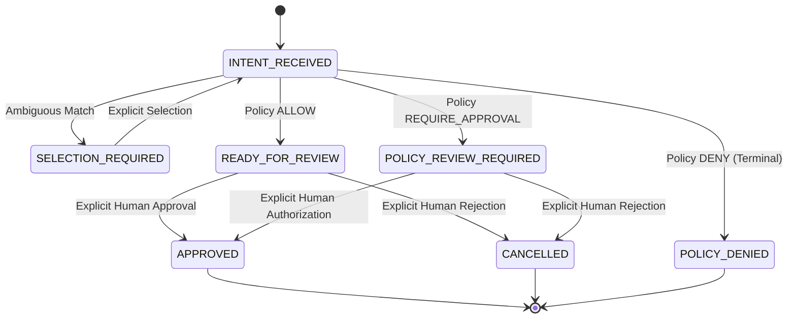

# Phase 3C Frontend Audit & Architecture Plan
## Human-in-the-Loop Purchase Authorization Dashboard

**Date:** 2026-10-26  
**Auditor:** Principal Frontend Architect & Application Security Engineer  
**Target:** `apps/web` (Next.js 15.1.4, React 19, TypeScript 5.7)

---

## 1. Existing Frontend Architecture

- **Framework:** Next.js 15.1.4 (App Router) with React 19.
- **Styling System:** Vanilla CSS (`apps/web/src/app/globals.css`) with CSS custom properties, responsive grid/flex layouts, glassmorphism design tokens (`.glass-panel`), Plus Jakarta Sans and JetBrains Mono typography, status badges (`.badge-warning`, `.badge-success`, `.badge-danger`, `.badge-info`), warning banners, and dark mode theme.
- **Existing Routes:**
  - `/`: Main dashboard with platform status, health, proposal simulator, and audit events.
  - `/orders/success`: Order success return route handling buyer redirect.
  - `/orders/cancelled`: Order cancellation return route.
  - `/orders/approved`: Alias to success route.
  - `/api/[...path]`: Dynamic Next.js route handler acting as a proxy forwarding requests to the API Gateway (`API_GATEWAY_URL`, default `http://localhost:4000`).
- **Dependencies:** `@agentpay/contracts: workspace:*`, `next: 15.1.4`, `react: 19.0.0`, `react-dom: 19.0.0`.

---

## 2. Reusable Components & Hooks Assessment

- **Current State:** The existing `apps/web/src/app/page.tsx` is an all-in-one simulator component (~660 lines) that handles state inline with `useState` and `useEffect`.
- **Planned Refactoring & Modularization:**
  - `components/ui/`: Reusable primitives (`Button`, `Alert`, `Badge`, `Card`, `Modal`/`Dialog`, `Skeleton`).
  - `components/catalog/`:
    - `ProductSearchForm`: Input validation, debounced submission, error display.
    - `CandidateCard`: Accessible card rendering candidate title, merchant, formatted price, currency, availability, and selection trigger.
    - `CandidateList`: Grid of candidates with explicit selection state.
  - `components/proposals/`:
    - `ProposalList`: Table/cards of proposals with status filter and pagination.
    - `ProposalDetail`: Comprehensive breakdown of product, merchant, quantity, unit price, authoritative total, policy outcome, policy reasons.
    - `DecisionDialog`: Explicit confirmation dialog for approval or rejection with reason input.
    - `ProposalAuditTimeline`: Server-authoritative audit trail for the selected proposal.
  - `lib/api/`: Centralized API client (`ApiClient`) handling gateway proxy transport, request correlation IDs, identity headers, and normalized error responses.
  - `lib/formatting/`: Pure currency formatter supporting 0-decimal (JPY), 2-decimal (USD, EUR, GBP), and 3-decimal (KWD, BHD) currencies via `Intl.NumberFormat` without floating-point hazards.

---

## 3. Actual API Contracts and Response Envelopes

### 3.1 Product Search: `POST /api/products/search`
- **Request:** `ProductSearchQuerySchema` (`{ query: string, merchantPreference?: string, currency?: string, maxResults?: number }`).
- **Response:** `ProductSearchResultSchema` (`{ query, candidates: ProductCandidate[], totalFound, status: 'EXACT_MATCH' | 'SELECTION_REQUIRED' | 'NO_MATCHES', providerId, executionTimeMs }`).

### 3.2 Purchase Intent Workflow: `POST /api/purchase-intents`
- **Request:** `CreatePurchaseIntentInputSchema` (`{ rawIntent: string, selectedCandidate?: { providerId, providerProductId, expectedUnitPriceMinor, expectedCurrency, quantity, requestId, idempotencyKey } }`).
- **Response Envelopes:**
  - `201 Created` (`outcome: 'PROPOSAL_CREATED'`, `proposal: StoredPurchaseProposal`, `policyDecision: PolicyDecision`).
  - `200 OK` (`outcome: 'POLICY_REVIEW_REQUIRED'`, `proposal: StoredPurchaseProposal`, `policyDecision: PolicyDecision`).
  - `200 OK` (`outcome: 'SELECTION_REQUIRED'`, `candidates: ProductCandidate[]`, `query: string`).
  - `409 Conflict` (`outcome: 'PRICE_CHANGED_RECONFIRMATION_REQUIRED'`, `previousPriceMinor`, `currentPriceMinor`, `currency`).
  - `404 Not Found` (`code: 'PRODUCT_NOT_FOUND'`).
  - `422 Unprocessable` (`code: 'OUT_OF_STOCK'`).
  - `403 Forbidden` (`outcome: 'POLICY_DENIED'`, `policyDecision: PolicyDecision`).

### 3.3 New Phase 3C Endpoints to Add to Gateway
- `GET /api/purchase-intents`: Lists proposals owned by authenticated principal.
- `GET /api/purchase-intents/:id`: Retrieves single proposal with ownership verification.
- `POST /api/purchase-intents/:id/approve`: Explicit human approval.
- `POST /api/purchase-intents/:id/reject`: Explicit human rejection with reason.
- `GET /api/purchase-intents/:id/audit-events`: Fetches proposal-specific audit history.

---

## 4. Proposal Lifecycle & Allowed Transitions

---

## 5. Authentication & Ownership Behavior

- The UI delegates authentication to the API Gateway.
- In development/test mode, the user can toggle or specify an authenticated principal identity (`dev-user-principal-01`, `principal-alice`, `principal-bob`) via a principal switcher in the header.
- The API proxy forwards the `x-principal-id` header to the API Gateway.
- If the gateway runs in production mode without dev identity enabled, the gateway strictly fails closed (401 Unauthorized). The UI will display a clear "Authentication Required (Fail-Closed)" security banner.

---

## 6. Frontend-to-Gateway Networking

- The browser client sends requests to `/api/*` (Next.js server-side route handler `apps/web/src/app/api/[...path]/route.ts`).
- The Next.js handler proxies requests to `API_GATEWAY_URL` (`http://localhost:4000` or Docker network DNS `http://api-gateway:4000`).
- No internal backend credentials or secrets are exposed to browser JavaScript.

---

## 7. Existing Test Infrastructure

- **Playwright:** Configured in `playwright.config.ts`, running on Chromium against web server. Baseline tests in `tests/e2e/home.spec.ts` (12 tests, 100% passing).
- **Vitest:** Configured in `vitest.config.ts` for unit and integration testing.

---

## 8. Identified Gaps and Implementation Plan

1. **Gateway Extensions:**
   - Add `GET /api/purchase-intents` (filter by principal).
   - Add `POST /api/purchase-intents/:id/approve`.
   - Add `POST /api/purchase-intents/:id/reject`.
   - Add `GET /api/purchase-intents/:id/audit-events`.
2. **Contracts & Agent Service:**
   - Add `listProposals` to `ProposalRepository` in `@agentpay/contracts` and implement in `InMemoryProposalRepository` and `PostgresProposalRepository`.
   - Add `PROPOSAL_APPROVED` and `PROPOSAL_REJECTED` to `AuditEventTypeSchema`.
   - Update `agent-service` with `GET /proposals?principalId=...`.
3. **Frontend Implementation:**
   - Centralized typed API client in `apps/web/src/lib/api/client.ts`.
   - Currency formatters in `apps/web/src/lib/formatting/currency.ts`.
   - Modular components for search, candidate card/list, disambiguation, proposal dashboard, policy review, decision modals, and audit timeline.
   - Comprehensive dashboard integrated on the main page with clear tabs:
     - **Tab 1: Product Search & Discovery** (search, candidate list, explicit selection, revalidation, price change dialog).
     - **Tab 2: Authorization Dashboard** (proposals list, detail view, policy review breakdown, explicit approval and rejection buttons).
     - **Tab 3: Foundation Simulator** (preserves existing elements so baseline tests remain 100% green).
4. **Automated Test Coverage:**
   - Unit tests for formatting, search validation, candidate mapping, and policy display.
   - Gateway integration tests for search, proposal listing, approval, rejection, and isolation.
   - Playwright E2E tests for the 10 required Phase 3C scenarios.
